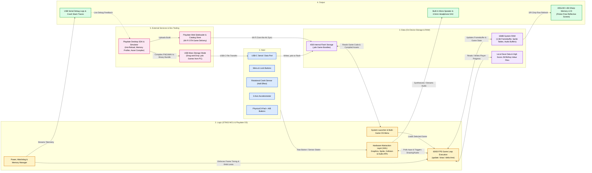

# Comparative Analysis

Following the guidelines in `Synthesis review.md`, this comparative analysis reviews **3 products** related to our pocket handheld & indie game dev platform problem, all explicitly mentioned by our interview participants (`P1`–`P4`):
1. **Panic Playdate** (Physical Device & SDK ,  mentioned by **P1, P2**)
2. **Arduboy FX** (Microcontroller Handheld ,  mentioned by **P4**)
3. **PICO-8** (Fantasy Console & Dev Platform ,  mentioned by **P2**)

---

## 1. Product Comparison Matrix

| Product | What it does well | What does not fit our participants (based on interviews) | One pattern, flow, or feature worth borrowing |
| :--- | :--- | :--- | :--- |
| **1. Panic Playdate** *(Physical Handheld + SDK)* Mentioned by **P1, P2** | **Friendly enclosure & frictionless game loading:** Clean, minimalist finished look that casual players aren't afraid to toss in a tote bag (**P1**). Includes a official desktop simulator with live debugging (**P2**) and wireless sideloading over Wi-Fi or simple USB drag-and-drop (**P1, P3**). | **Ergonomics & price barrier:** Uses a compact vertical/square form factor that can cause hand cramping ("Game Boy claw") during longer action sessions compared to a wider horizontal grip (**P1, P2, P3**), and its $199 price tag takes it out of the accessible DIY/maker hardware space (**P2, P4**). | **Over-the-air / Web-based Sideloading & Desktop Simulator:** Allowing players to add `.bin` games via a simple browser/USB interface (or SD card launcher menu) without command-line tools (**P1, P3, P4**), paired with a PC simulator so devs don't have to flash over serial for every tweak (**P2**). |
| **2. Arduboy FX** *(Microcontroller Handheld)* Mentioned by **P4** | **Open C++/Arduino ecosystem & multi-game flash menu:** Built on standard microcontroller tooling (Arduino/PlatformIO) with a built-in boot menu holding dozens of games (**P4**). Embraces the slim, pocketable maker aesthetic with visible PCB/silkscreen artistry (**P2, P4**). | **Extreme vertical cramping & harsh audio/display limits:** Credit-card thin vertical layout cramps hands after 15–20 minutes (**P1, P2, P4**), exposed/industrial styling intimidates casual players (**P1**), and 1-bit monochrome OLED + raw piezo buzzer make readable UI and pleasant sound design tough without helper tools (**P4**). | **Multi-Game Bootloader Menu + Copy-Paste Starter Template:** A pre-built launcher menu that reads multiple compiled games off flash/SD storage (**P3, P4**), paired with a 30-line "Hello World" C++ template (`init`, `update`, `draw`, sprite helper, button polling) that compiles out-of-the-box (**P2, P3, P4**). |
| **3. PICO-8** *(Fantasy Console & Dev Suite)* Mentioned by **P2** | **Intentional constraints & zero-friction asset pipeline:** Strict limits (128x128 screen, 16 colors, 6 buttons) kill scope creep and focus devs 100% on core mechanics (**P2, P3, P4**). Built-in sprite editor, tilemap tool, and tone sequencer eliminate manual byte-array conversion (**P2, P4**). | **Software-only (no dedicated physical hardware):** Runs on a PC monitor, where devs are already fatigued from sitting all day (**P4**), or requires buying and configuring a separate Linux retro handheld like a Miyoo Mini (**P2**) rather than working as a cohesive custom physical product out of the box. | **Clean HAL (`_init()`, `_update()`, `_draw()`) & Built-In Asset Converter:** Hiding low-level SPI display drivers and timers behind three simple lifecycle functions (**P3**), alongside a single-step converter script that turns PNG sprites and melodies into C header arrays automatically (**P2, P4**). |

---

## 2. System Diagram: Panic Playdate (Hardware + Dev/Loading Ecosystem)

Below is the system diagram for **Panic Playdate**, illustrating its **Input**, **Logic**, **Data**, **Output**, and **External Services** across both gameplay and the developer/sideloading pipeline:

---

## 3. Key Takeaways for Our ESP32 Handheld Project

1. **Borrow from PICO-8 (Developer Experience):** Provide a clean C++ Hardware Abstraction Layer (`init()`, `update()`, `draw()`) with built-in sprite rendering (`PokemonSprite` / tile helpers), bounding-box collision, and a script to convert images into C `.h` byte arrays so developers never wrestle with raw SPI transfers.
2. **Borrow from Playdate (Iteration & Industrial Design):** Support a **desktop simulator** (via our configured **Wokwi / PlatformIO** setup) so developers can test gameplay loops without waiting on serial hardware flashes, and house the electronics in a **smooth, enclosed horizontal shell** with tactile buttons so casual players (**P1**) feel safe picking it up and heavy gamers (**P2, P3, P4**) don't get hand cramps.
3. **Borrow from Arduboy FX (Longevity & Sharing):** Include a **multi-game launcher menu** or **SD card / web USB loader** alongside a **30-line Quickstart template** so the handheld never becomes a single-game "desk ornament" (**P4**) and non-technical friends can easily try new games (**P1, P3**).
