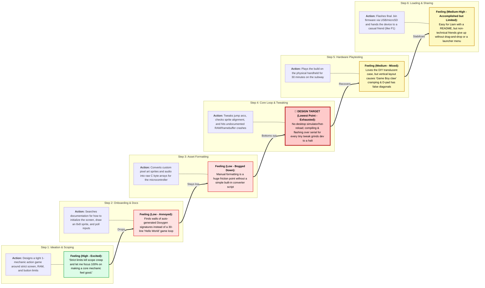
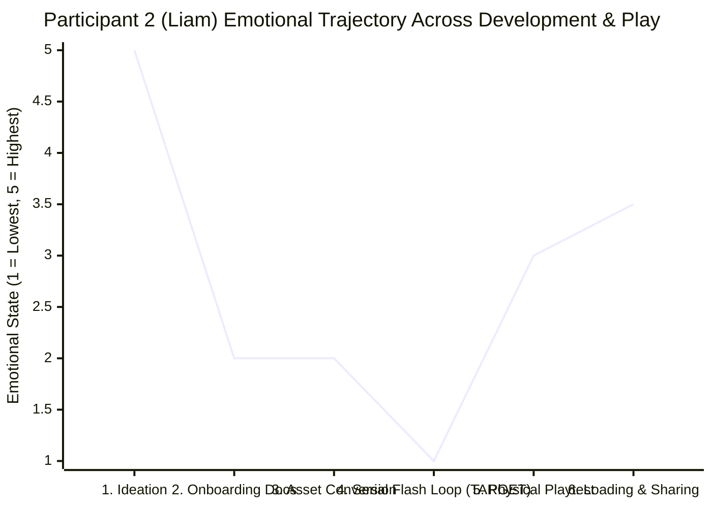

# Journey Map: Making & Sharing a Game on a Custom Handheld

Following the guidelines in `Synthesis review.md`, this journey map traces **Participant 2 (Liam, 26 — Indie Game Dev & Heavy Gamer)** as he builds a small action game for a microcontroller-based handheld and tries to load it onto the hardware. 

Steps run left to right in chronological order, feelings are recorded beneath each step, a line connects the emotional highs and lows, and the **lowest point** is marked as the **Design Target**.

---

## 1. Visual Journey Map (Left-to-Right Flow & Feelings)

---

## 2. Emotional Curve (High to Low Line Chart)

This chart plots Liam's emotional state (from `1 = Lowest / Frustrated` to `5 = Highest / Excited`) across the 6 steps of his journey:

---

## 3. Step-by-Step Breakdown & Design Target

| Step | What the Participant Did | How the Participant Felt | Traceability (Interview Quotes) |
| :--- | :--- | :--- | :--- |
| **1. Ideation & Scoping** | Scoped a small, mechanics-first game tailored to the ESP32's screen, button, and memory limits. | **High (5/5 — Inspired & Focused):** Energized by fantasy-console-style restrictions that prevent scope creep. | *"When you have strict limits on resolution, color palette, button count, or RAM, like on an ESP32, it kills scope creep. You stop worrying about fancy shaders... and focus 100% on making a single core mechanic feel good."* (P2) |
| **2. Onboarding & Docs** | Looked up how to initialize the display, draw a sprite at `(x, y)`, play a beep, and read buttons. | **Low (2/5 — Impatient):** Frustrated by contextless API references and undocumented hardware quirks. | *"Working, copy-pasteable minimal code examples make it; walls of auto-generated Doxygen function signatures with zero context break it."* (P2) |
| **3. Asset Formatting** | Converted sprite sheets and sound effects into byte arrays expected by the C/C++ codebase. | **Low (2/5 — Tedious):** Slowed down by manual asset pipeline chores instead of designing gameplay. | *"On custom or microcontroller-based hardware specifically, converting sprites and audio into whatever byte array or custom format the engine expects is usually a huge friction point if there isn't a simple converter script."* (P2) |
| **4. Core Loop & Tweaking** 🎯 **LOWEST POINT** | Adjusted jump physics and sprite alignments while debugging mysterious memory crashes over serial. | **Lowest (1/5 — Grinding Halt):** Waiting on full hardware compilation and serial flashing for every tiny change kills creative momentum. | *"If I have to compile and flash hardware over serial every single time I want to tweak a jump arc or check a sprite alignment, development grinds to a halt... The only time hardware limits become frustrating is when the bottleneck is poorly documented, like mystery memory fragmentation crashing the device."* (P2) |
| **5. Physical Playtest** | Took the handheld on the subway for a 15–30 minute play session to test controls. | **Medium (3/5 — Satisfied but Cramped):** Appreciates having physical buttons over a phone touchscreen, but suffers hand fatigue if ergonomics/D-pad aren't dialed in. | *"Vertical handhelds look nostalgic, but after 30 minutes of playing an action game, my hands cramp up, what people call the 'Game Boy claw.' ... If the D-pad has false diagonals or the buttons feel mushy... action games become frustrating."* (P2) |
| **6. Loading & Sharing** | Loaded new `.bin` builds onto the handheld via `esptool`/SD card and shared with friends. | **Medium-High (3.5/5 — Proud yet Restricted):** Comfortable flashing via CLI himself, but realizes casual players (P1) won't touch CLI tools. | *"Flashing firmware via USB, using `esptool`, or dropping `.bin` files onto a microSD card doesn't bother me at all, as long as the steps are clearly written down in a README."* (P2) / *"If I have to install special drivers, use a command line, or format an SD card... I'm going to give up immediately."* (P1) |

> [!IMPORTANT]
> ### 🎯 Design Target (The Lowest Point)
> **Step 4 (The Hardware Iteration & Debugging Loop)** is the lowest emotional point on the map. To succeed as a game development platform, the system must eliminate the slow compile-flash-crash cycle by providing **a clean hardware abstraction layer (HAL), a fast desktop simulator/emulator (e.g., Wokwi or native PC preview), a 30-line starter template, and simple asset conversion scripts**—paired with a **horizontal ergonomic enclosure** and **SD/web-based multi-game loading** so finished games are effortless to play and share.
